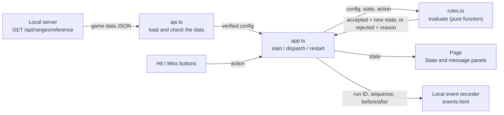
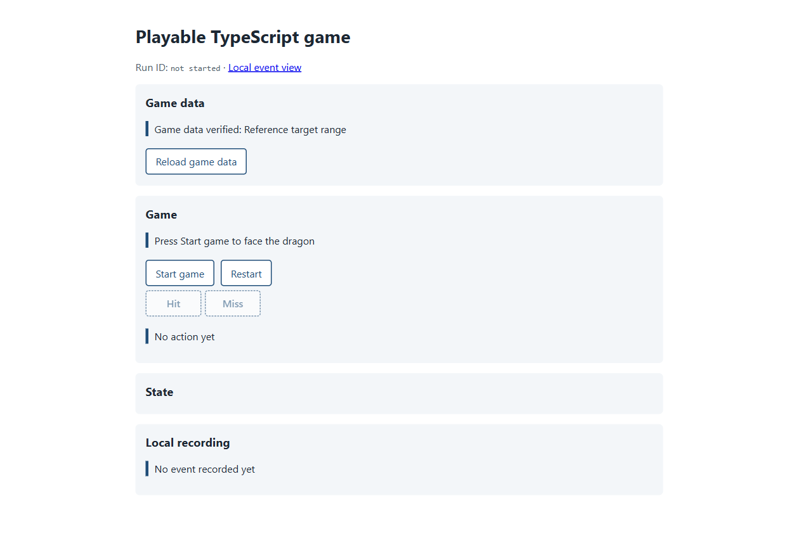
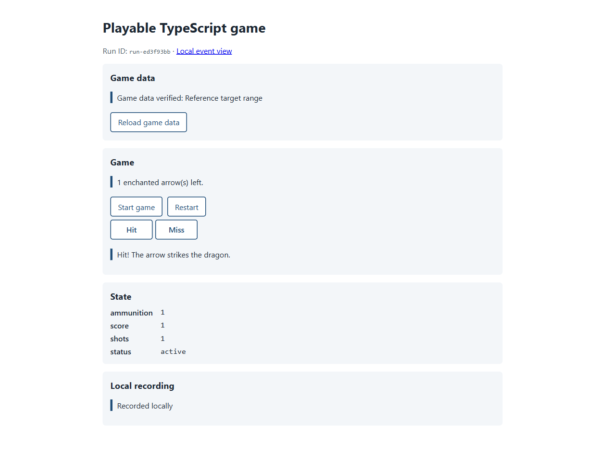
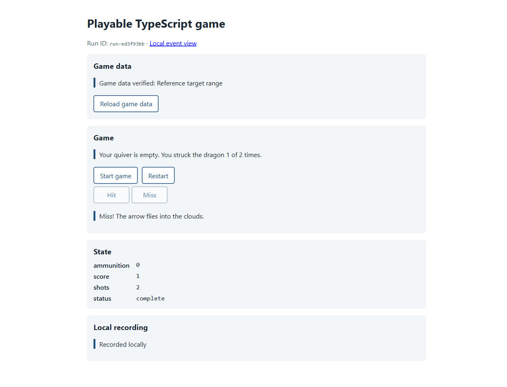
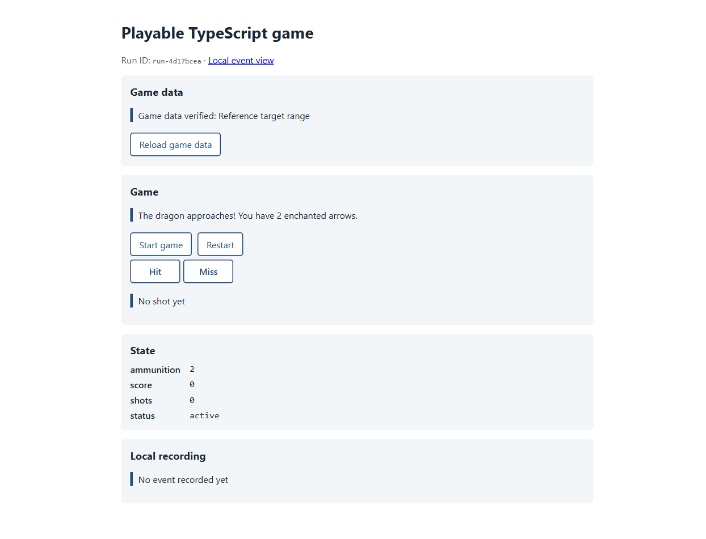
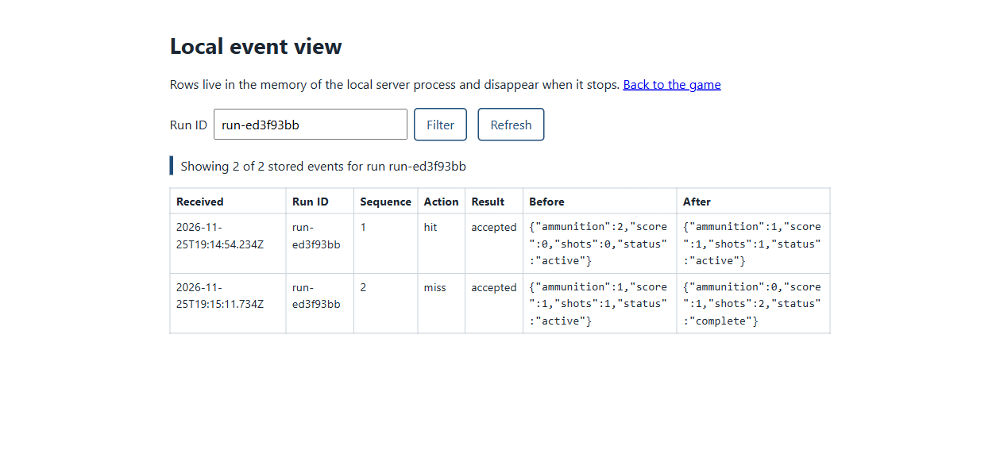

# Dragon's Last Stand

A small, playable browser game built in TypeScript for **Project 2 (Playable TypeScript game)** of the BP Software
Engineering Academy, Week 2. It follows the course's **target-range** route.

## Project at a glance

**Project 2 question:** *can another person start, make meaningful progress, finish and restart the game through its
browser controls?*

The course supplies the page, the buttons, the renderer, a small local game-data API, an event recorder and the release
tools. The project's own work is the game itself: typed game state, the rules, loading and checking the game data,
connecting the buttons to the rules, recording each shot, and tests that prove the rules behave as promised.

### How one button press travels



### Words used in this README

| Word | Meaning here |
|---|---|
| **State** | What the game remembers: `ammunition` (arrows left), `score`, `shots` and `status` (`active` or `complete`) |
| **Action** | One button press: `hit` or `miss` |
| **Rules / `evaluate`** | A pure function: same state + same action always gives the same result. It never changes the old state; it returns a new one, or rejects the action and keeps the state unchanged |
| **Fixture** | A course-supplied test case (R01–R05B) with a fixed input and the exact expected result |
| **Run ID / sequence** | Every Start or Restart gets a new run ID; each recorded shot in that run is numbered 1, 2, … |
| **Release** | A named, checked copy of the built game (`playable-01`) with a SHA-256 checksum for every file |

### What was proved

| # | Claim | Proof |
|---|---|---|
| 1 | The game data loads and is checked before play | "Game data verified: Reference target range"; HTTP errors, malformed JSON and unexpected data are reported and no game starts (browser checks) |
| 2 | A shot uses one arrow; a hit scores one | After one hit: arrows 1, score 1, shots 1 (screenshot 2); fixtures R02 and R03 pass |
| 3 | The last arrow ends the game, hit or miss | After a miss with the last arrow: arrows 0, score 1, shots 2, `complete`, buttons disabled (screenshot 3); R04 and a regression test pass |
| 4 | Nothing changes after the game is complete, and unknown actions are rejected | Fixtures R05A, R05B and a regression test pass: the state is returned unchanged with `INVALID_EVENT` / `GAME_COMPLETE` |
| 5 | Restart is a fresh game, not a patched old one | New run ID, arrows 2, score 0, shots 0, `active` (screenshot 4) |
| 6 | Every accepted shot is recorded | The event view lists run `run-ed3f93bb`, sequence 1 `hit` and 2 `miss`, with before/after state (screenshot 5) |
| 7 | The tests and the release pass | Rules 10 passed / 0 failed; browser 10 passed / 1 skipped; release `playable-01` verified, 47 files match (see Evidence) |

### Screenshots

**1. Game data loaded, waiting for Start** (Hit and Miss stay disabled until a game starts)



**2. After one hit:** 1 arrow left, score 1, shots 1, still active



**3. Game complete:** the last arrow missed; 0 arrows, score 1 of 2, status complete, buttons disabled



**4. Restart:** a new run ID and a fresh state (2 arrows, score 0, shots 0)



**5. Local event view** for run `run-ed3f93bb`: both shots, in order, with the state before and after each one



### Demo script (about 8 minutes)

| Step | Show | Command or action | What to say |
|---|---|---|---|
| 1 | Start the game | `npm ci` (first time), then `npm start`; open `http://127.0.0.1:4182` | "The page loads, then asks the API for the range data. It only says 'verified' once the data passes the check." |
| 2 | Play | **Start game**, **Hit**, then **Miss** | "Each shot uses one arrow; only a hit scores. With the last arrow used, the game is complete and the buttons switch off." |
| 3 | Restart | **Restart** | "A restart builds a fresh initial state and a new run ID. It never re-uses the finished game." |
| 4 | Events | **Local event view** link | "Every accepted shot is recorded with its run ID, sequence number and the state before and after." |
| 5 | Rules are pure | open `src/rules.ts` | "`evaluate` takes config, state and action and returns a result. It doesn't touch the page, the clock or randomness, which is why the tests can predict it exactly." |
| 6 | Tests | stop the server (Ctrl+C), then `npm test` | "The fixtures and my regression tests check every rule; the browser tests check start, play, finish, restart, request failures and recording." |
| 7 | Release | `python tools/release.py verify ../releases/playable-01` | "The release is a named copy with a checksum for every file, so I can show exactly what was released." |

**Questions a reviewer may ask:**
* *Why does a rejected shot leave the state unchanged?* The rules return the same state object with a reason, so a bad
  or late action can never damage a game in progress (fixtures R05A and R05B).
* *What happens if the game data request fails?* The message panel shows the failure (HTTP error, malformed or
  unexpected data), no game starts from it, and a failed reload keeps the current session.
* *Why is restart a fresh state?* `initialState(config)` is called again with a new run ID; the finished state is
  thrown away rather than edited.

---

## The game

The last dragon is attacking and the hero has a quiver of enchanted arrows. Each turn the hero fires one arrow, and
the shot is recorded as a **hit** or a **miss**.

| Rule | Behaviour |
|---|---|
| Start | The quiver holds the number of arrows set by the game data (2 in the reference range); score 0, shots 0 |
| Hit | Uses one arrow and scores one point |
| Miss | Uses one arrow and scores nothing |
| Finish | The game is complete as soon as the last arrow is used, whether that shot hits or misses |
| Rejected actions | An unknown action, or any shot after the game is complete, is rejected and the state stays exactly as it was (`INVALID_EVENT`, `GAME_COMPLETE`) |
| Restart | Starts a fresh game from the initial state, with a new run ID |

Game state is `ammunition`, `score`, `shots` and `status` (`active` or `complete`). The rules are pure functions
(`initialState` and `evaluate` in `src/rules.ts`), independent of the page, the clock and randomness, so the same
sequence of shots always gives the same result.

## Project structure

| Path | Purpose |
|---|---|
| `src/genre.ts` | Selects the `range` route |
| `src/models.ts` | Typed game state, actions, reject reasons and the result envelope, with their invariants |
| `src/rules.ts` | `initialState(config)` and `evaluate(config, state, action)` |
| `src/api.ts` | Loads the game data from `GET /api/ranges/reference`, reporting HTTP, malformed-JSON and unexpected-definition failures |
| `src/app.ts` | Load, start, dispatch, restart and event recording in the browser |
| `src/supplied/` | Course-supplied controls, renderer, configuration guard, telemetry and event view |
| `server/` | Course-supplied local host: page, game-data API, event collector and `/healthz` |
| `tests/learner.test.mjs` | Regression tests for this game |
| `tests/fixtures.test.mjs`, `fixtures/` | Course contract fixtures (range R01–R05B) |
| `tests/browser/` | Browser checks: lifecycle, request failures and recorded events |
| `tools/release.py` | Packs and verifies a named local release |

## Setup

Requirements: Node.js 22 or later, npm, Python 3. On Windows use `python` where the commands say `python3`.

```bash
npm ci                              # install the pinned dependencies (TypeScript 5.9.3, Playwright 1.61.0)
npx playwright install chromium     # once per machine, for the browser checks
npm start                           # build and serve the game at http://127.0.0.1:4182
```

Open `http://127.0.0.1:4182`, press **Start**, then use **Hit** and **Miss** until the quiver is empty, and
**Restart** for a new game. The local event view is at `http://127.0.0.1:4182/events.html`. Stop the server with
Ctrl+C. To use another port: `PORT=4183 npm start`.

## Checks

```bash
npm run check:boot      # the page, styles, modules, game-data routes, collector and /healthz all start
npm run check:rules     # contract fixtures and regression tests
npm test                # rule checks, then the browser checks (stop npm start first; the tests start their own server)
```

## Local release

```bash
npm test
python3 tools/release.py pack ../releases/playable-01
python3 tools/release.py verify ../releases/playable-01
python3 ../releases/playable-01/serve.py
P2_URL=http://127.0.0.1:4182 npm run check:browser    # check the running release
```

The release holds the compiled browser code, the local API and a SHA-256 inventory in `release.json`. Responses carry
an `X-Lab-Release` header naming the release. This is a local release, not a container, Kubernetes or BP deployment.

## Evidence

Results recorded in this repository:

| Check | Result | Record |
|---|---|---|
| Rule tests (`npm run check:rules`) | 10 passed, 0 failed, 13 skipped (the skipped tests are the treasure-hunt fixtures, which don't apply to the range route) | `npm-test.log` |
| Range contract fixtures | R01 start, R02 hit, R03 miss, R04 last arrow completes, R05A unknown event rejected, R05B shot after completion rejected: all pass | `npm-test.log` |
| Regression tests | last-arrow miss completes without scoring; unknown event after completion is `GAME_COMPLETE`; a full game is deterministic | `npm-test.log` |
| Browser checks (`npm run check:browser`) | 10 passed, 1 skipped: start, play, finish and fresh restart; visible loading; HTTP, malformed-JSON and unexpected-definition failures reported without starting a game; failed reload keeps the session; events recorded and visible, with collector failure reported without undoing the action | `npm-test.log` |
| Release pack | `playable-01` (range): 47 files packed | `release-pack.log` |
| Release verify | 47 files match `release.json` (SHA-256), before and after running | `release-verify.log`, `release-verify-after.log` |
| Running release | `X-Lab-Release: playable-01` | `release-header.log`, `release-browser.log` |

Full outcome-by-outcome notes are in [`evidence.md`](evidence.md).
